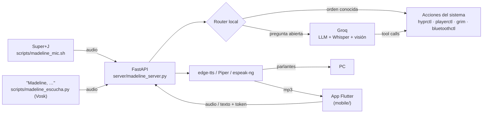

# Madeline

> Asistente de voz personal para escritorio Linux (Hyprland), con app móvil compañera.


Madeline (inspirada en la protagonista de *Celeste*) escucha órdenes por voz o texto, controla el PC
—aplicaciones, música, volumen, ventanas, Bluetooth, actualizaciones— y responde hablando. Las
preguntas abiertas se resuelven con un LLM en Groq; las órdenes comunes se resuelven **localmente**,
sin gastar tokens.

---

## Características

- **Palabra de activación**: di *"Madeline, …"* y te escucha, como Alexa. La detección es offline
  (Vosk) y nada sale del PC hasta que oye su nombre.
- **Control por voz** con un atajo global (`Super + J`): grabar, transcribir con Whisper y ejecutar.
- **Router local**: las órdenes frecuentes (multimedia, volumen, apps, clima, charla corta) se
  detectan con expresiones regulares y no llaman al LLM. Pensado para el plan gratuito de Groq.
- **Herramientas (tool calling)** cuando hace falta el LLM: abrir/cerrar apps, mover ventanas,
  Bluetooth, buscar en la web, reporte del sistema, actualizaciones, captura y análisis de pantalla.
- **Voz natural** con `edge-tts` (`es-MX-DaliaNeural`) y efecto de audio opcional; voz local de
  respaldo con Piper o `espeak-ng` si no hay internet.
- **Memoria a largo plazo local**: recuerda lo que le pides ("recuerda que…"), los datos que
  cuentas al pasar ("estoy aprendiendo Flutter") y las conversaciones. Todo se guarda en SQLite
  con embeddings de Ollama en tu PC; a Groq solo llegan los 2–3 recuerdos relevantes, o ninguno.
- **Recados y agenda**: "recuérdame que debo pagar la luz" queda en tus recados, que se ven en
  la barra (Noctalia). "¿Qué tengo mañana?" y "agéndame dentista el jueves a las 4" usan tu
  Google Calendar.
- **App móvil (Flutter)**: hablarle desde el celular, recibir la respuesta en audio, ver capturas,
  un panel de sensores del PC en tiempo real, un deck de botones, los recados y la agenda (también
  fuera de casa: se sincronizan al volver) y una ayuda con frases de ejemplo.
- **Seguridad**: token obligatorio para peticiones desde la red (`X-Madeline-Token`), confirmación
  antes de apagar/reiniciar, validación de URLs y de nombres de apps.

## Arquitectura



## Estructura del proyecto

```
.
├── server/
│   ├── madeline_server.py   # API FastAPI: router local, herramientas, Groq y voz
│   ├── memoria.py           # Memoria a largo plazo (SQLite + embeddings locales)
│   ├── recados.py           # Recados sin hora (data/recados.json)
│   └── agenda.py            # Google Calendar y horas dichas ("a las 4" -> 16:00)
├── noctalia/madeline-recados/  # Widget de los recados para la barra de Noctalia
├── mobile/                  # App Flutter compañera (Android)
├── scripts/
│   ├── madeline_mic.sh      # Atajo de micrófono para Hyprland (Super+J)
│   ├── madeline_escucha.py  # Palabra de activación "Madeline" (Vosk, offline)
│   ├── madeline_escucha_toggle.sh  # Pausar/reanudar la escucha (Super+Shift+J)
│   ├── calibrar_activacion.py      # Graba tu voz para calibrar la activación
│   └── autorizar_google.py  # Conecta la agenda con tu cuenta de Google (una vez)
├── tests/
│   ├── test_madeline.py     # Tests del router y de la seguridad (sin red)
│   ├── test_memoria.py      # Tests de la memoria
│   └── test_escucha.py      # Tests de la palabra de activación
├── .env.example             # Variables de entorno de ejemplo
└── requirements.txt
```

## Requisitos

- Linux con **Hyprland** (usa `hyprctl`) y PipeWire/PulseAudio.
- Python 3.12+.
- Herramientas del sistema: `mpv`, `ffmpeg`, `grim`, `playerctl`, `parecord`, `jq`, `notify-send`,
  `bluetoothctl`. Opcionales: `espeak-ng` o `piper-tts` (voz offline), `checkupdates`, `paru`/`yay`.
- Una API key de [Groq](https://console.groq.com/keys).
- [Ollama](https://ollama.com) con el modelo de embeddings: `ollama pull embeddinggemma` (opcional:
  sin él, la memoria busca por palabras clave).

En Arch / CachyOS:

```bash
sudo pacman -S mpv ffmpeg grim playerctl libpulse jq libnotify bluez-utils espeak-ng pacman-contrib
```

## Instalación

```bash
git clone https://github.com/AQ-Keric/madeline.git
cd madeline

python -m venv .venv
.venv/bin/pip install -r requirements.txt

cp .env.example .env   # y completa GROQ_API_KEY y MADELINE_TOKEN

# Modelo de voz offline para la palabra de activación (~40 MB)
mkdir -p data/modelos && cd data/modelos
curl -LO https://alphacephei.com/vosk/models/vosk-model-small-es-0.42.zip
unzip vosk-model-small-es-0.42.zip && rm vosk-model-small-es-0.42.zip
```

## Uso

### Servidor

```bash
.venv/bin/python server/madeline_server.py
# API en http://0.0.0.0:8000  ·  docs interactivas en http://localhost:8000/docs
```

Para arrancarla con la sesión y tener el atajo de voz, en `hyprland.conf`:

```ini
bind = SUPER, J, exec, /ruta/a/madeline/scripts/madeline_mic.sh
bind = SUPER SHIFT, J, exec, /ruta/a/madeline/scripts/madeline_escucha_toggle.sh
exec-once = bash -c 'cd /ruta/a/madeline && .venv/bin/python server/madeline_server.py'
exec-once = bash -c 'cd /ruta/a/madeline && .venv/bin/python scripts/madeline_escucha.py'
exec-once = /ruta/a/madeline/scripts/madeline_bienvenida.sh
```

Hay dos formas de hablarle:

- Di **"Madeline, …"** (por ejemplo *"Madeline, pon música"*). Suena un aviso y graba hasta que te
  callas. Si solo dices "Madeline", espera unos segundos a que digas la orden. `Super + Shift + J`
  pausa o reanuda la escucha.
- Presiona `Super + J` para empezar a grabar y otra vez para enviar.

Reconoce tanto "Madeline" como "Madelain" (ma-de-lain). Si no te detecta bien, graba muestras con
`scripts/calibrar_activacion.py` (quedan en `data/calibracion/`) y prueba con
`MADELINE_ESCUCHA_DEBUG=1`, que muestra lo que entiende Vosk en cada frase.

La escucha continua usa ~4 % de un núcleo y ~190 MB de RAM. Lo que dices antes de "Madeline" se
procesa solo en tu PC y se descarta.

### App móvil

```bash
cd mobile
flutter pub get
flutter build apk --dart-define=MADELINE_TOKEN=<tu_token>
```

No hace falta configurar la IP: la app busca sola al PC en la red del celular (prueba el puerto 8000
en las direcciones de esa red) y recuerda la última que funcionó. Si cambia, la vuelve a buscar. En
Ajustes se puede escribir a mano. El celular debe estar en la misma red que el PC.

El ícono (la montaña de Celeste con la fresa) se genera con `mobile/tool/generar_icono.py`.

### Endpoints principales

| Método | Ruta              | Descripción                                          |
|--------|-------------------|------------------------------------------------------|
| GET    | `/`               | Estado del servidor                                  |
| POST   | `/comando_texto`  | Orden en texto (`origen=pc` o `telefono`)            |
| POST   | `/comando_audio`  | Orden en audio; se transcribe con Whisper            |
| POST   | `/callar`         | Corta la voz que esté sonando en el PC               |
| POST   | `/bienvenida`     | Saludo + clima al iniciar sesión                     |
| GET    | `/captura/{id}`   | Descarga una captura de pantalla (una sola vez)      |
| GET    | `/bandeja`        | Capturas pedidas desde el PC que esperan al celular  |
| GET    | `/sensores`       | CPU, RAM y temperaturas para el panel del celular    |
| GET    | `/recados`        | Recados pendientes                                   |
| POST   | `/recados`        | Agrega un recado (`{"texto": …}`)                    |
| DELETE | `/recados/{id}`   | Tacha un recado                                      |
| GET    | `/agenda?dias=7`  | Eventos de Google Calendar desde hoy                 |

Las peticiones que no vienen del propio PC necesitan el header `X-Madeline-Token`.

## Memoria

| Le dices                                   | Qué hace                                         | Tokens de Groq |
|--------------------------------------------|--------------------------------------------------|----------------|
| "Recuerda que mi hermana se llama Ana"     | Guarda el dato                                   | 0              |
| "Estoy aprendiendo Flutter, ¿qué opinas?"  | Guarda el dato y responde normalmente            | lo de siempre  |
| "¿Qué recuerdas de mi hermana?"            | Lee la memoria                                   | 0              |
| "¿Qué sabes de mí?"                        | Lista los últimos datos                          | 0              |
| "Olvida lo de mi hermana"                  | Borra el dato y las charlas que lo repiten       | 0              |
| Cualquier pregunta que vaya a Groq         | Agrega los 2–3 recuerdos relevantes (si hay)     | ~30–60 extra   |

Las órdenes ("sube el volumen") no se guardan. Los recuerdos viven en `data/memoria.db`, que no se
sube al repositorio. El modelo de embeddings usa ~700 MB de RAM solo mientras está cargado (Ollama lo
descarga tras `MADELINE_EMBED_KEEP_ALIVE` sin uso) y tarda ~25 ms por búsqueda en CPU.

## Recados y agenda

| Le dices                                     | Qué hace                                        |
|----------------------------------------------|-------------------------------------------------|
| "Recuérdame que debo pagar la luz"           | Agrega un recado (sin hora)                     |
| "¿Qué recados tengo?"                        | Los lee                                         |
| "Ya pagué la luz" / "borra todos los recados" | Tacha el que más se parece, o todos            |
| "¿Qué tengo mañana?" / "¿y esta semana?"     | Lee tu Google Calendar                          |
| "Agéndame dentista el jueves a las 4"        | Crea el evento (de 1 a 6 sin aclarar es de tarde) |
| "Recuérdame en 10 minutos que…"              | Sigue siendo el recordatorio hablado (0 tokens) |

Van por Groq con las tools de su tema, igual que el resto. "Recuerda que…" (sin *-me*) sigue
guardando en la memoria.

**Barra**: el widget `noctalia/madeline-recados` muestra cuántos recados hay y los lista en el
tooltip. El clic abre un panel para escribir recados nuevos y tacharlos. Se instala una vez:

```bash
noctalia msg plugins source add madeline path ~/asistente_local/noctalia
noctalia msg plugins enable keric/madeline-recados
# y en ~/.config/noctalia/config.toml: "recados" en la barra + [widget.recados] type = "keric/madeline-recados:widget"
```

**Google Calendar**: sin autorizar, Madeline lee la agenda con la URL iCal del calendario de
quickshell (`~/.config/ml4w/settings/gcal-urls`) pero no puede crear eventos. Para crearlos, sigue
los pasos al inicio de `scripts/autorizar_google.py` y córrelo una vez. El permiso queda en
`data/google/token.json`.

## Configuración

| Variable                 | Descripción                                               | Por defecto          |
|--------------------------|-----------------------------------------------------------|----------------------|
| `GROQ_API_KEY`           | API key de Groq (obligatoria)                             | —                    |
| `MADELINE_TOKEN`         | Token para peticiones desde la red                        | vacío (sin auth)     |
| `MADELINE_VOZ`           | Voz de edge-tts                                           | `es-MX-DaliaNeural`  |
| `MADELINE_EFECTO_VOZ`    | `sutil`, `holografico` o `ninguno`                        | `ninguno`            |
| `MADELINE_PIPER_MODELO`  | Modelo `.onnx` de Piper para la voz offline               | vacío                |
| `MADELINE_MODELO_EMBED`  | Modelo de embeddings de Ollama                            | `embeddinggemma`     |
| `MADELINE_EMBED_KEEP_ALIVE` | Tiempo que el modelo queda en RAM tras usarse          | `10m`                |
| `MADELINE_MEMORIA_DB`    | Ruta de la base de datos de recuerdos                     | `data/memoria.db`    |

## Tests

```bash
.venv/bin/python -m unittest discover tests
```

No llaman a Groq ni ejecutan nada en el sistema: `subprocess` y el cliente de Groq se reemplazan por mocks.
La app tiene los suyos (sincronización de recados): `cd mobile && flutter test`.

## Autor

**Keric** — [@AQ-Keric](https://github.com/AQ-Keric)
