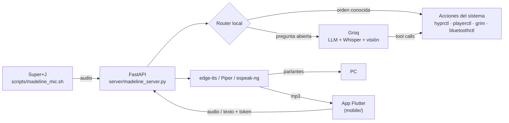

# Madeline

> Asistente de voz personal para escritorio Linux (Hyprland), con app móvil compañera.


Madeline (inspirada en la protagonista de *Celeste*) escucha órdenes por voz o texto, controla el PC
—aplicaciones, música, volumen, ventanas, Bluetooth, actualizaciones— y responde hablando. Las
preguntas abiertas se resuelven con un LLM en Groq; las órdenes comunes se resuelven **localmente**,
sin gastar tokens.

---

## Características

- **Control por voz** con un atajo global (`Super + J`): grabar, transcribir con Whisper y ejecutar.
- **Router local**: las órdenes frecuentes (multimedia, volumen, apps, clima, charla corta) se
  detectan con expresiones regulares y no llaman al LLM. Pensado para el plan gratuito de Groq.
- **Herramientas (tool calling)** cuando hace falta el LLM: abrir/cerrar apps, mover ventanas,
  Bluetooth, buscar en la web, reporte del sistema, actualizaciones, captura y análisis de pantalla.
- **Voz natural** con `edge-tts` (`es-DO-RamonaNeural`) y efecto de audio opcional; voz local de
  respaldo con Piper o `espeak-ng` si no hay internet.
- **App móvil (Flutter)**: hablarle desde el celular, recibir la respuesta en audio, ver capturas
  y un panel de sensores del PC en tiempo real.
- **Seguridad**: token obligatorio para peticiones desde la red (`X-Madeline-Token`), confirmación
  antes de apagar/reiniciar, validación de URLs y de nombres de apps.

## Arquitectura



## Estructura del proyecto

```
.
├── server/
│   └── madeline_server.py   # API FastAPI: router local, herramientas, Groq y voz
├── mobile/                  # App Flutter compañera (Android)
├── scripts/
│   └── madeline_mic.sh      # Atajo de micrófono para Hyprland (Super+J)
├── tests/
│   └── test_madeline.py     # Tests del router y de la seguridad (sin red)
├── .env.example             # Variables de entorno de ejemplo
└── requirements.txt
```

## Requisitos

- Linux con **Hyprland** (usa `hyprctl`) y PipeWire/PulseAudio.
- Python 3.12+.
- Herramientas del sistema: `mpv`, `ffmpeg`, `grim`, `playerctl`, `parecord`, `jq`, `notify-send`,
  `bluetoothctl`. Opcionales: `espeak-ng` o `piper-tts` (voz offline), `checkupdates`, `paru`/`yay`.
- Una API key de [Groq](https://console.groq.com/keys).

En Arch / CachyOS:

```bash
sudo pacman -S mpv ffmpeg grim playerctl libpulse jq libnotify bluez-utils espeak-ng pacman-contrib
```

## Instalación

```bash
git clone https://github.com/AQ-Keric/madeline.git
cd madeline

python -m venv .venv
.venv/bin/pip install -r requirements.txt

cp .env.example .env   # y completa GROQ_API_KEY y MADELINE_TOKEN
```

## Uso

### Servidor

```bash
.venv/bin/python server/madeline_server.py
# API en http://0.0.0.0:8000  ·  docs interactivas en http://localhost:8000/docs
```

Para arrancarla con la sesión y tener el atajo de voz, en `hyprland.conf`:

```ini
bind = SUPER, J, exec, /ruta/a/madeline/scripts/madeline_mic.sh
exec-once = bash -c 'cd /ruta/a/madeline && .venv/bin/python server/madeline_server.py'
exec-once = bash -c 'sleep 8 && curl -s -X POST http://127.0.0.1:8000/bienvenida'
```

Presiona `Super + J` para empezar a grabar y otra vez para enviar.

### App móvil

```bash
cd mobile
flutter pub get
flutter build apk --dart-define=MADELINE_TOKEN=<tu_token> --dart-define=MADELINE_IP=<ip_del_pc>
```

El celular debe estar en la misma red que el PC.

### Endpoints principales

| Método | Ruta              | Descripción                                          |
|--------|-------------------|------------------------------------------------------|
| GET    | `/`               | Estado del servidor                                  |
| POST   | `/comando_texto`  | Orden en texto (`origen=pc` o `telefono`)            |
| POST   | `/comando_audio`  | Orden en audio; se transcribe con Whisper            |
| POST   | `/callar`         | Corta la voz que esté sonando en el PC               |
| POST   | `/bienvenida`     | Saludo + clima al iniciar sesión                     |
| GET    | `/captura/{id}`   | Descarga una captura de pantalla (una sola vez)      |
| GET    | `/sensores`       | CPU, RAM y temperaturas para el panel del celular    |

Las peticiones que no vienen del propio PC necesitan el header `X-Madeline-Token`.

## Configuración

| Variable                 | Descripción                                               | Por defecto          |
|--------------------------|-----------------------------------------------------------|----------------------|
| `GROQ_API_KEY`           | API key de Groq (obligatoria)                             | —                    |
| `MADELINE_TOKEN`         | Token para peticiones desde la red                        | vacío (sin auth)     |
| `MADELINE_VOZ`           | Voz de edge-tts                                           | `es-DO-RamonaNeural` |
| `MADELINE_EFECTO_VOZ`    | `sutil`, `holografico` o `ninguno`                        | `sutil`              |
| `MADELINE_PIPER_MODELO`  | Modelo `.onnx` de Piper para la voz offline               | vacío                |
| `TELEGRAM_TOKEN` / `TELEGRAM_CHAT_ID` | Enviar capturas a Telegram (opcional)        | vacío                |

## Tests

```bash
.venv/bin/python -m unittest discover tests
```

No llaman a Groq ni ejecutan nada en el sistema: `subprocess` y el cliente de Groq se reemplazan por mocks.

## Autor

**Keric** — [@AQ-Keric](https://github.com/AQ-Keric)
